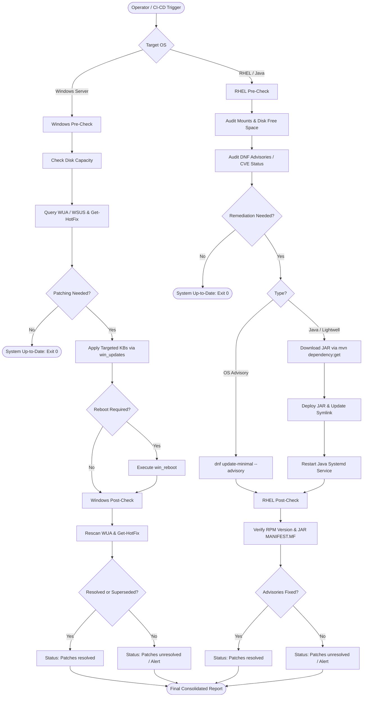

# Patch_Demo

This project demonstrates the **RHEL** and **Windows** patching process for specific **RHSA** (Red Hat Security Advisory), **CVE** (Common Vulnerabilities and Exposures) and **KB** (Knowledge Base) IDs.

### Demo Workflow
The demo covers the following four phases:

1.  **Backup_Snapshot**: Take backup snapshot for possible restore.
2.  **Pre_Check**: Validating the current system state and requirements.
3.  **Patch**: Executing the update for the specified vulnerabilities for RHEL and Windows
4.  **Patch Rollback**: Demonstrating the ability to revert changes if issues arise.
5.  **Restore_Snapshot**: Restore if Patch rollback fails
6.  **Reboot**: Reboot if required
7.  **Post_Check**: Verifying successful installation and system health.
8.  **Compliance_Report_Update**: Generate a report for patch status


### EDA Workflow activation 

Rulebook will launch Patch_Workflow within 5secs of actions
Time of 5 secs will be used here as the event trigger

### Patch_Workflow Diagram
# Automated Patch Verification & Remediation Workflow

This document illustrates the execution lifecycle across both Windows and RHEL/Java targets for pre-checks, remediation, post-verification, and reporting.

---

## High-Level Lifecycle Flowchart



---

## Detailed ASCII Architecture Diagram

```text
====================================================================================================
                        AUTOMATED PATCH VERIFICATION & REMEDIATION WORKFLOW
====================================================================================================

      +-------------------------------------------------------------------------------+
      |                               OPERATOR / CI-CD                                |
      |           Triggers Ansible Playbooks with Target KBs, CVEs, or JARs           |
      +-------------------------------------------------------------------------------+
                                             |
                      +----------------------+----------------------+
                      |                                             |
                      v                                             v
     ====================================          ====================================
               WINDOWS WORKFLOW                              RHEL / JAVA WORKFLOW
     ====================================          ====================================
                      |                                             |
                      v                                             v
             [ 1. PRE-CHECK PHASE ]                        [ 1. PRE-CHECK PHASE ]
                      |                                             |
     +----------------------------------+          +----------------------------------+
     | - Query Disk Space & Capacity    |          | - Audit Disk Space (df/mounts)   |
     | - Query WSUS / WUA via           |          | - Run `dnf updateinfo` for CVEs  |
     |   win_updates (state: searched)  |          |   & RHSA Advisories              |
     | - Check Get-HotFix for target KB |          |                                  |
     +----------------------------------+          +----------------------------------+
                      |                                             |
                      v                                             v
            Is Patching Required?                         Is Patching Required?
             /                  \                          /                  \
          [YES]                [NO]                     [YES]                [NO]
            |                    |                        |                    |
            |             (Exit: System                   |             (Exit: System
            |              Up-to-Date)                    |              Up-to-Date)
            v                                             v
     [ 2. REMEDIATION PHASE ]                      [ 2. REMEDIATION PHASE ]
            |                                             |
     +----------------------------------+          +----------------------------------+
     | - Apply targeted KBs via         |          | - DNF minimal security update    |
     |   win_updates                    |          |   OR fetch Lightwell rebuilt JAR |
     | - Orchestrate system reboot      |          |   via Maven dependency:get       |
     |   if required (win_reboot)       |          | - Update /usr/share/java symlink |
     +----------------------------------+          | - Restart Java systemd service   |
            |                                      +----------------------------------+
            |                                             |
            v                                             v
     [ 3. POST-CHECK PHASE ]                       [ 3. POST-CHECK PHASE ]
            |                                             |
     +----------------------------------+          +----------------------------------+
     | - Re-scan WUA for needed updates |          | - Verify package version via rpm |
     | - Inspect Get-HotFix registry    |          | - Validate JAR META-INF manifest |
     +----------------------------------+          | - Check systemd service status   |
            |                                      +----------------------------------+
            v                                             |
     Evaluate Status:                                     v
     - Installed? -> PASS                          Evaluate Status:
     - Superseded? -> PASS                         - Fixed RPM active? -> PASS
     - Still Needed? -> FAIL (Alert)               - Lightwell JAR loaded? -> PASS
            |                                      - Old version active? -> FAIL
            \                                             /
             \                                           /
              v                                         v
     ==================================================================================
                                    FINAL STATUS REPORT
                       "Patches resolved"  OR  "Patches unresolved"
     ==================================================================================
```
## Workflow Visualization
# Automated Patch Verification & Remediation Demo

An Ansible-based automation suite designed for enterprise vulnerability management, pre/post-patch verification, and automated package remediation across hybrid **RHEL (Red Hat Enterprise Linux)** and **Microsoft Windows Server** environments.

This repository provides production-ready and debug-mode playbooks to audit, validate, and remediate OS packages, Java dependencies rebuilt with security backports (Red Hat Lightwell), and Windows Cumulative/Security Intelligence updates (KBs).

---

## Key Features

* **Pre-Patch & Post-Patch Verification:**
* Independent assessment of package status before applying changes to prevent unnecessary service disruptions.
* Verification that security patches are either installed or superseded.


* **Cross-Platform Support:**
* **Linux (RHEL 8/9):** DNF advisory checks, CVE impact auditing (`RHSA-2026:8259`, `CVE-2026-33412`), and system storage monitoring.
* **Windows Server (2019/2022):** Windows Update Agent (WUA) queries, WSUS compliance audits, and targeted KB validation (`KB4055223`, `KB2267602`).


* **Secure Java Supply Chain (Red Hat Lightwell):**
* Download, verification, and classpath management for secure upstream rebuilt Java artifacts (e.g., `org.json:json`).
* Native Maven integration with repository isolation (`settings.xml`).
* Direct integrity verification inspecting internal `META-INF/MANIFEST.MF` release markers.


* **Fail-Safe & Debug Playbooks:**
* Mock audit tasks using `ansible.builtin.debug` for sandbox demonstrations, dry runs, and reporting without altering live server state.


---

## Repository Structure

```text
├── playbooks/
│   ├── rhel_pre_check.yml          # Audit CVEs, disk usage, and pending DNF advisories
│   ├── rhel_post_check.yml         # Validate resolved advisories on RHEL hosts
│   ├── rhel_lightwell_maven.yml    # Fetch & verify secure Lightwell Java dependencies
│   ├── windows_pre_check.yml       # Query WSUS/WUA for missing or superseded KBs
│   ├── windows_post_check.yml      # Verify targeted KBs are resolved post-reboot
│   ├── audit_disk_space.yml        # Multi-OS disk space check (Linux & Windows)
│   └── demo_debug_audit.yml        # Dry-run execution for presentations/sandboxes
├── inventory/
│   ├── hosts.yml                   # Inventory file for RHEL and Windows target groups
└── README.md                       # Project documentation

```

---

## Prerequisites

### Control Node

* **Ansible Core:** `>= 2.14`
* **Required Collections:**
```bash
ansible-galaxy collection install ansible.builtin ansible.windows community.windows

```


### Managed Hosts

* **RHEL Targets:**
* Python 3.9+
* `unzip` (for JAR manifest inspection)


* **Windows Targets:**
* PowerShell 5.1+
* WinRM configured (CredSSP, NTLM, or Kerberos)


---

## Usage Guide

### 1. Windows Pre- and Post-Patch Verification

Audit specific KBs (e.g., Defender updates or .NET hotfixes) to verify whether updates are needed, and re-run after patching to confirm resolution:

```bash
# Run pre-patch audit to determine if patching is needed
ansible-playbook -i inventory/hosts.yml playbooks/windows_pre_check.yml -e "target_kb_ids=['KB4055223','KB2267602']"

# Run post-patch verification to confirm resolution
ansible-playbook -i inventory/hosts.yml playbooks/windows_post_check.yml -e "target_kb_ids=['KB4055223','KB2267602']"

```

**Status Indicators Returned:**

* `Patching required` / `System up-to-date` (Pre-check)
* `Patches resolved` / `Patches unresolved` (Post-check)

---

### 2. Java / Lightwell Dependency Deployment (RHEL)

Download and register a Red Hat Lightwell rebuilt secure JAR (`org.json`) using Maven dependency resolution, isolating it from the system DNF repository configuration:

```bash
ansible-playbook -i inventory/hosts.yml playbooks/rhel_lightwell_maven.yml \
  -e "group_id=org.json" \
  -e "artifact_id=json" \
  -e "artifact_version=20220320.0.0.rhlw-00003"

```

The playbook executes:

1. Maven installation and `/root/.m2/settings.xml` profile configuration pointing to the validated repository.
2. `mvn dependency:get` execution to pull the package into the local cache.
3. Verification of internal `MANIFEST.MF` release markers (`rhlw`).
4. Automatic symlink/classpath updates and systemd service reload.

---

### 3. Disk Space Capacity Audits

Check partition capacity and warn when available disk space drops below defined safety thresholds (80% used on Linux / <20% free on Windows):

```bash
# Run cross-platform disk inspection
ansible-playbook -i inventory/hosts.yml playbooks/audit_disk_space.yml

```

---

### 4. Sandbox / Dry-Run Demonstrations

To test reporting workflows without modifying actual server state or connecting to a live WSUS/DNF repo:

```bash
ansible-playbook -i inventory/hosts.yml playbooks/demo_debug_audit.yml

```

---

## Troubleshooting & Common Pitfalls

| Issue | Root Cause | Solution |
| --- | --- | --- |
| `'AnsibleUnsafeText object' has no attribute 'kb'` | Calling `.kb` on `win_updates.updates` keys instead of values. | Use `win_updates.updates.values() | selectattr('kb', 'defined')` in Jinja filters. |
| `Cannot download repomd.xml: All mirrors were tried` | Maven URL mistakenly configured in `/etc/yum.repos.d/`. | Ensure `disablerepo: "lightwell_repo"` is used on DNF tasks or delete the repo file. |
| `404: Not Found` on `.sha256` URL | Upstream repository hosts `.sha1` or no checksum sidecars. | Verify via `unzip -p <jar> META-INF/MANIFEST.MF` instead of fetching external `.sha256` files. |

